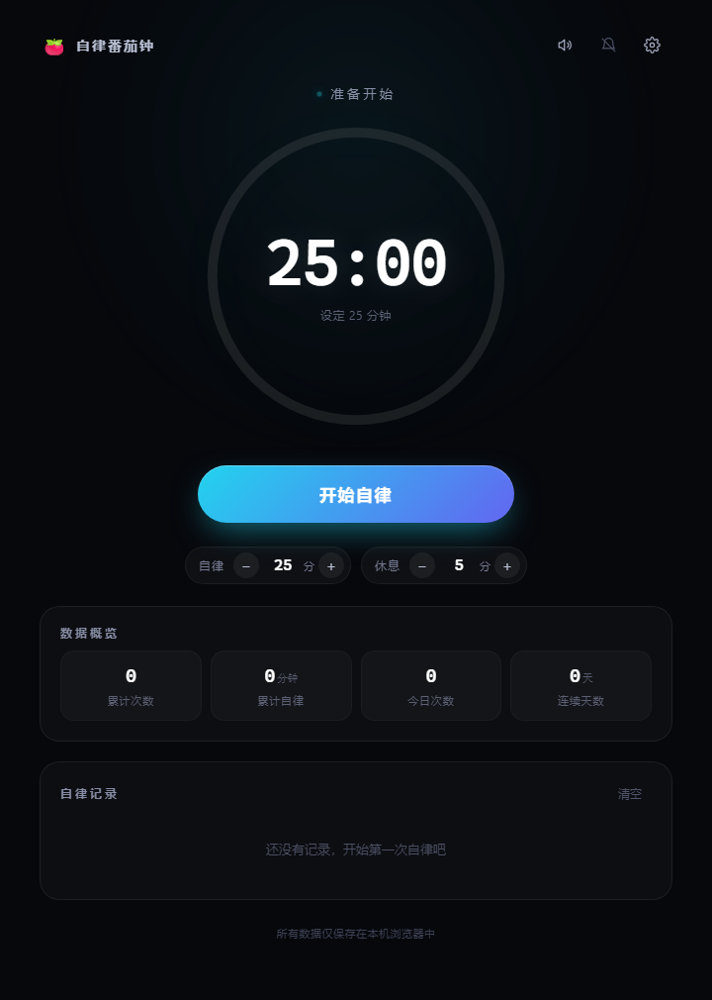
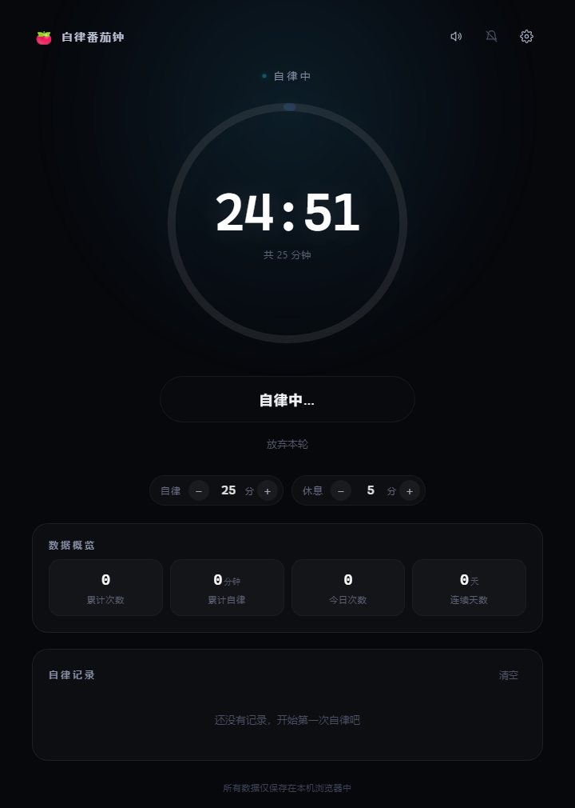
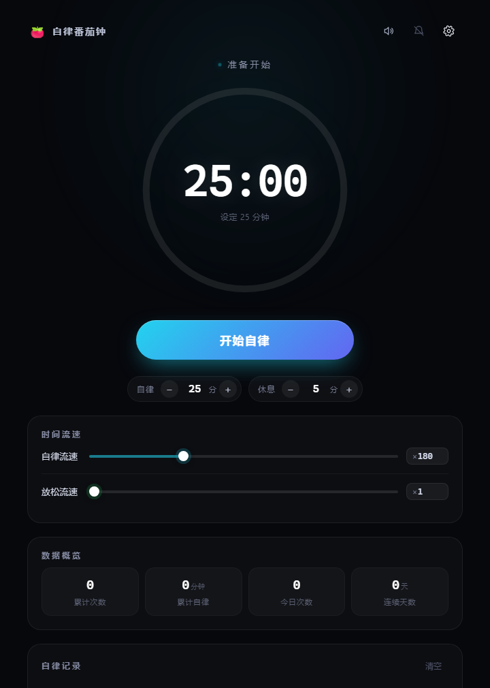

<div align="center">


# 自律番茄钟

**把 25 分钟的自律，速通成 8 秒。**


</div>

---

## 这是什么

不是又一个番茄钟。

这个工具把「时间流速」做成了可调参数：点下「开始自律」，按钮立刻变灰锁死，时间开始疯狂跳动——默认设定下，**25 分钟的倒计时在现实里只需要 8.3 秒**。

它当然不能替你自律。但如果你要的是「我确实坐下来了」的那个心理暗示，或者只是想把一个完整倒计时的仪式感快速看完，这是目前最省时间的方案。

而且它诚实：每一轮都记在账上，时长、时间、连续天数，一条不落。

<div align="center">
  
  
</div>

<div align="center">
  
</div>

## 它怎么运转

```
        ┌──────────────┐   自律结束    ┌──────────────┐
        │   自律中      │ ───────────→ │  放松一下     │
        │  按钮变灰     │              │  按钮变绿     │
        │  时间狂奔     │              │  按正常流速   │
        └──────────────┘              └──────────────┘
               ↑                              │
               │        开始新一轮             │ 放松结束
               └──────────────────────────────┘
```

- 自律阶段：按钮**变灰不可按**，上方显示「自律中」，时间按设定倍率飞速跳动
- 自律结束：按钮**变绿**，文案变成「放松一下」，等你亲手点
- 放松阶段：按正常流速计时，按钮同样锁死
- 放松结束：回到起点，随时可以开始下一轮

## 特性

| | |
|---|---|
| **双阶段计时** | 自律 → 放松，节奏自动衔接，不用手动切换 |
| **流速独立可调** | 自律 / 放松各自设置，1× 到 600×，滑块拖动或直接输入倍率 |
| **时长随手改** | 主界面直接 `−` / `+` 调节，不用进设置；步长按量级自适应 |
| **完整记录** | 每次自律的时间点、时长，加上累计次数 / 累计时长 / 今日次数 / 连续天数 |
| **计时期间锁定** | 时长和流速在计时中禁用——本轮参数在开始时已固定，改了也不会生效，索性不让改 |
| **结束提示** | Web Audio 现场合成的提示音（无外部音频文件）+ 可选桌面通知 |
| **数据不出本机** | 全部存在 localStorage，没有账号、没有服务端、没有埋点 |
| **零依赖** | 单个 HTML 文件，双击就能跑 |

## 开始使用

### 网页版

下载 [`番茄钟.html`](番茄钟.html)，双击打开。就这样。

### Android

到 [**Releases**](https://github.com/HH-567/speedrun-pomodoro/releases/latest) 下载最新的 `.apk`，传到手机后点击安装（需要允许「安装未知来源应用」）。

- 最低支持 Android 5.0（API 21）
- 包名 `com.xiaoxiao.tomato`
- 116 KB，无任何权限申请

> APK 使用 debug 证书签名，仅供自行安装使用，不能上架应用商店。仓库根目录也放了一份 [`自律番茄钟.apk`](自律番茄钟.apk)，与 Release 附件内容相同。

## 时间流速对照

拖到不同倍数，现实里要熬多久：

| 倍率 | 现实 1 秒等于 | 25 分钟自律实际耗时 |
|:---:|:---:|:---:|
| 1× | 1 秒 | 25 分钟 |
| 10× | 10 秒 | 2 分 30 秒 |
| 60× | 1 分钟 | 25 秒 |
| **180×（默认）** | **3 分钟** | **8.3 秒** |
| 600× | 10 分钟 | 2.5 秒 |

倍率只在齿轮设置面板里显示，主界面保持干净。

## 从源码构建 APK

`apk-build/` 是一套**不依赖 Gradle、不依赖 Android Studio** 的最小构建链，只用到 JDK 和 Android build-tools。

```bash
cd apk-build
bash tools/get.sh   # 首次：下载 JDK 17 + Android SDK 组件（约 300MB）
bash build.sh       # 出包 → out/tomato.apk
```

Windows 下也可以直接双击 `build.bat`。

构建流程：`aapt2 compile` → `aapt2 link` → `javac` → `d8` → `zipalign` → `apksigner`。

改了根目录的 `番茄钟.html` 之后，记得同步到 `apk-build/assets/index.html` 再打包。

## 技术实现

**计时核心**

`requestAnimationFrame` 驱动，每帧按真实时间差累加虚拟时间：

```js
session.realMs += dt;
session.virtual += (dt / 1000) * session.speed;
```

`dt` 上限 500ms，防止掉帧或切回标签页时时间跳变；`visibilitychange` 时重置基准，切到后台不计时。

**参数快照**

每轮开始时把时长和流速快照进 `session`，计时过程中改设置只影响下一轮。这也是为什么计时期间要把设置项锁掉——否则用户会以为改动立刻生效。

**Android 壳**

WebView 容器，但页面不是从 `file://` 加载的：`shouldInterceptRequest` 把 `https://tomato.local/` 的请求映射到 assets 目录。这样页面运行在一个稳定的 https 来源下，localStorage 不会因为 unique origin 而丢数据，历史记录才能真的存住。

## 许可

[MIT](LICENSE)
